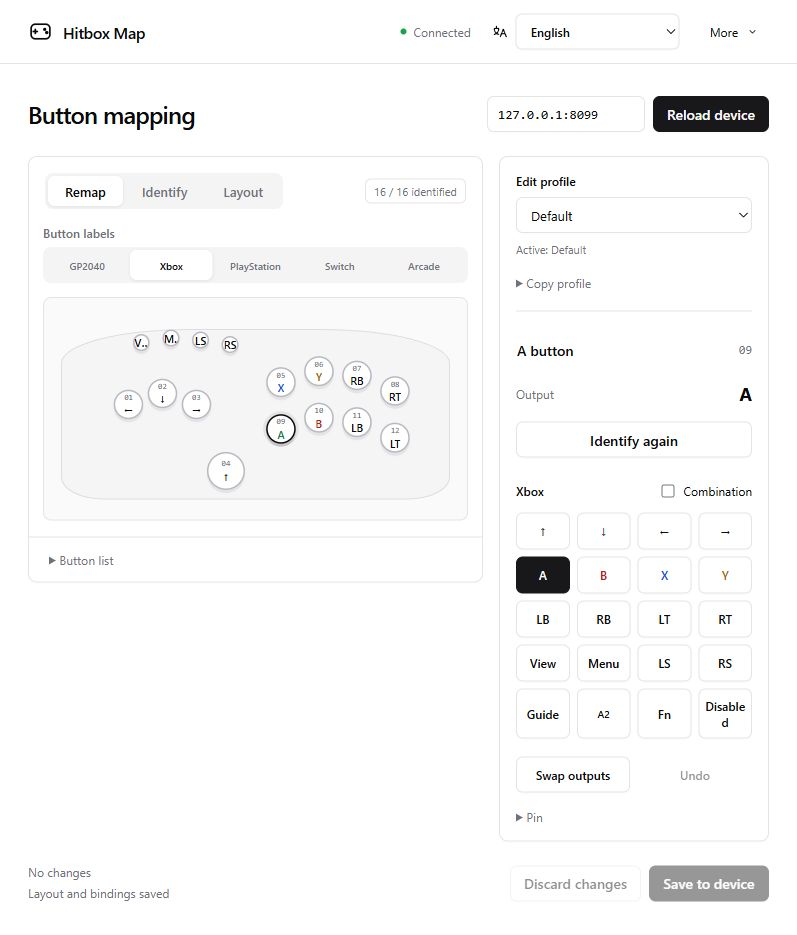
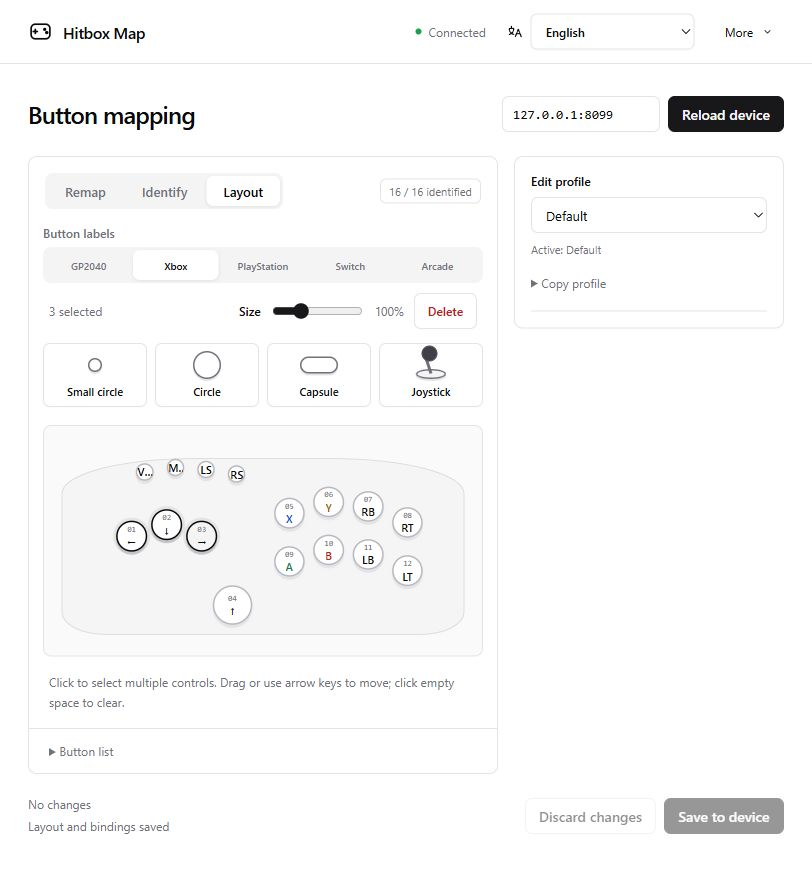

[简体中文](README.md) | [English](README.en.md) | [日本語](README.ja.md)

# Hitbox Map

A local button mapper for GP2040-CE controllers. Arrange the buttons to match their physical positions, identify the physical buttons once, then click the corresponding positions to remap them.

## Start and connect

1. Download the archive from [Releases](https://github.com/MooWantFree/GP2040-hitbox-easy-UI/releases), then open `HitboxMap.exe`.
3. Hold the controller's Menu / Start button while plugging in USB to enter Web Config mode. If you changed the startup shortcut, use your own setting.
4. Enter the device address on the management page, normally `192.168.7.1`, and click "Connect".

The default management page address is `http://127.0.0.1:29301`.

# Remapping workflow

## Arrange the buttons

Switch to `Layout` and adjust the button positions to match your hitbox's physical layout.

**Add buttons:** Drag buttons from the top or left onto the canvas.

**Adjust button positions:** Click a button to select it, then click other buttons to select multiple buttons.

Drag any selected button to move the selection together, or use the arrow keys for fine adjustments. Resize or delete buttons above the canvas; with multiple buttons selected, scale them together by a percentage while keeping their original size ratios. A joystick moves, resizes and deletes as one control. Select a single button to rename it on the right.

## Identify physical buttons

1. Switch to `Identify` and click any button.
2. Release all buttons, then press and release the button that corresponds to that position.
3. Repeat until all the buttons you need have been identified. Identify the joystick's up, down, left and right directions separately, pushing only one direction at a time.

If a physical button is already bound to another position, you can confirm replacement; the old position becomes unidentified. Two physical buttons sharing the same pin cannot be remapped independently. Identify the buttons again after changing controllers or wiring.

Button positions, shapes, names and identification results save automatically. Once "Layout and bindings saved" appears, you can continue using them the next time you open the page.

## Remap and save

Switch to `Remap` and choose GP2040, Xbox, PlayStation, Switch or Arcade under "Button labels".

2. Click a button on the canvas and choose its output on the right.
3. Click "Save to device", review the changes, then click "Confirm save".
4. When finished, you will be asked whether to restart, or you can click "More" → "Restart device" in the upper right.

**We recommend keeping a Menu / Start output to make it easier to enter Web Config mode next time.** Button labels change the display only. Use Firmware settings to change the firmware input mode, SOCD, macros or lighting effects.

The layout saves automatically; device mappings need manual confirmation. Avoid saving device settings from another page while editing here.

## Back up, move and update

- Use "More → Export layout / Import layout" to back up or move the button arrangement and identification results. Importing replaces the current layout.
- "More → Back up device" downloads a `.gp2040` backup; a backup is also created before saving mappings. To restore it, import the file under **Data Backup and Restoration** in Firmware settings. It takes effect immediately after import.
- Local layouts and device backups are stored in the `data` folder beside the EXE. Copy it when moving to another computer; before updating, exit through the tray, replace the EXE and keep `data` and your custom `locales` files.
