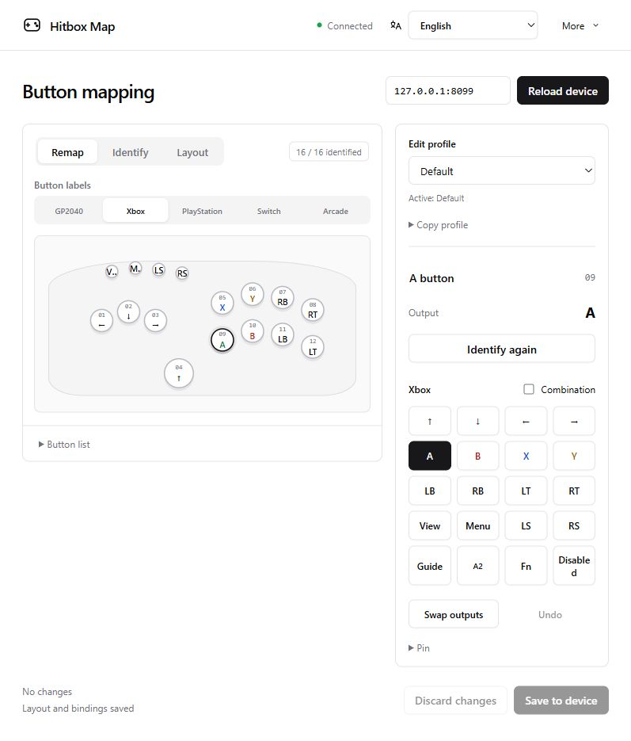
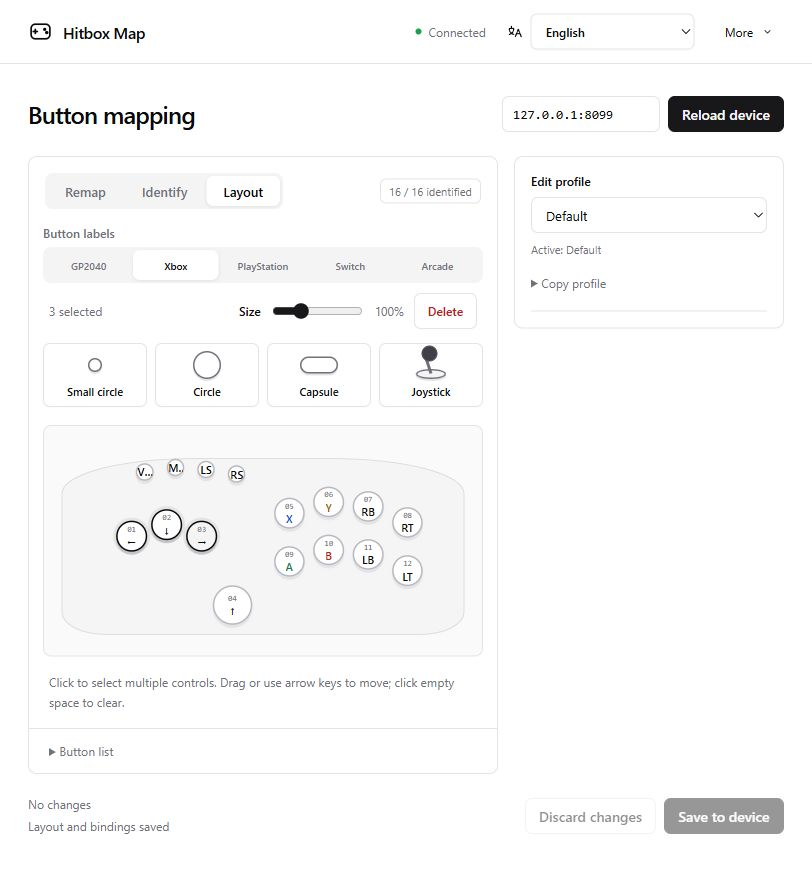

[简体中文](README.md) | [English](README.en.md) | [日本語](README.ja.md)

# Hitbox Map

GP2040-CE コントローラーのボタン割り当てを変更するローカルツールです。実機の位置に合わせてボタンを配置し、実機のボタンを一度識別すれば、以降は対応する位置をクリックして割り当てを変更できます。

## 起動と接続

1. [Releases](https://github.com/MooWantFree/GP2040-hitbox-easy-UI/releases) から圧縮ファイルをダウンロードし、`HitboxMap.exe` を開きます。
3. コントローラーの Menu / Start を押しながら USB を接続し、Web 設定モードに入ります。起動時の操作を変更している場合は、自分の設定に従ってください。
4. 管理画面にデバイスのアドレスを入力し、「接続」をクリックします。初期アドレスは `192.168.7.1` です。

管理画面の初期アドレスは `http://127.0.0.1:29301` です。

# 割り当て変更の手順

## ボタンを配置する

`レイアウト`に切り替え、hitbox の実際の配置に合わせてボタンの位置を調整します。

**ボタンを追加する：** 上側または左側のボタンをキャンバスへドラッグします。

**ボタンの位置を調整する：** ボタンをクリックすると選択でき、続けて別のボタンをクリックすると複数選択できます。

選択したボタンのどれかをドラッグするとまとめて移動でき、矢印キーで微調整もできます。サイズ調整と削除はキャンバス上部で行います。複数選択時は、元のサイズ比を保ったままパーセント指定でまとめて拡大・縮小します。ジョイスティックは1つの部品として移動、サイズ変更、削除します。ボタンを1つ選ぶと、右側で名前を変更できます。

## 実機のボタンを識別する

1. `識別`に切り替え、任意のボタンをクリックします。
2. すべてのボタンを離し、その位置に対応するボタンを押して離します。
3. 必要なボタンをすべて識別するまで繰り返します。ジョイスティックの上下左右は個別に識別し、毎回1方向だけに倒してください。

実機のボタンがすでに別の位置に紐付いている場合は、確認して置き換えられます。元の位置は未識別に戻ります。同じピンを共有する2つの実機ボタンを個別に割り当てることはできません。コントローラーや配線を変更した場合は、再識別してください。

ボタンの位置、形状、名前、識別結果は自動保存されます。「レイアウトと紐付けを保存しました」と表示されれば、次回もそのまま使えます。

## 割り当てを変更して保存する

`割り当て`に切り替え、「ボタン表記」で GP2040、Xbox、PlayStation、Switch、Arcade のいずれかを選びます。

2. キャンバス上のボタンをクリックし、右側で出力を選びます。
3. 「デバイスに保存」をクリックし、変更内容を確認して「保存を確定」をクリックします。
4. 完了すると再起動するか確認されます。または、右上の「その他」→「デバイスを再起動」をクリックします。

**次回も Web 設定モードに入りやすいよう、Menu / Start の出力を残しておくことをおすすめします。** ボタン表記の選択で変わるのは表示だけです。ファームウェアの入力モード、SOCD、マクロ、LED エフェクトを設定する場合は、ファームウェア設定を使用してください。

レイアウトは自動保存されますが、デバイスの割り当て変更は手動で保存を確定する必要があります。編集中は、別の画面からデバイス設定を保存しないようにしてください。

## バックアップ、移行、更新

- 「その他 → レイアウトを書き出す / レイアウトを読み込む」で、ボタンの配置と識別結果をバックアップ、移行できます。読み込むと現在のレイアウトを置き換えます。
- 「その他 → デバイスをバックアップ」で `.gp2040` バックアップをダウンロードします。割り当ての保存前にも自動でバックアップします。復元するには、ファームウェア設定の **Data Backup and Restoration** でファイルを読み込みます。読み込み後すぐに適用されます。
- ローカルのレイアウトとデバイスのバックアップは、EXE と同じ場所の `data` フォルダーに保存されます。別の PC へ移す際は一緒にコピーしてください。更新時は先にトレイから終了し、EXE を差し替えて、`data` と独自の `locales` ファイルを残してください。
