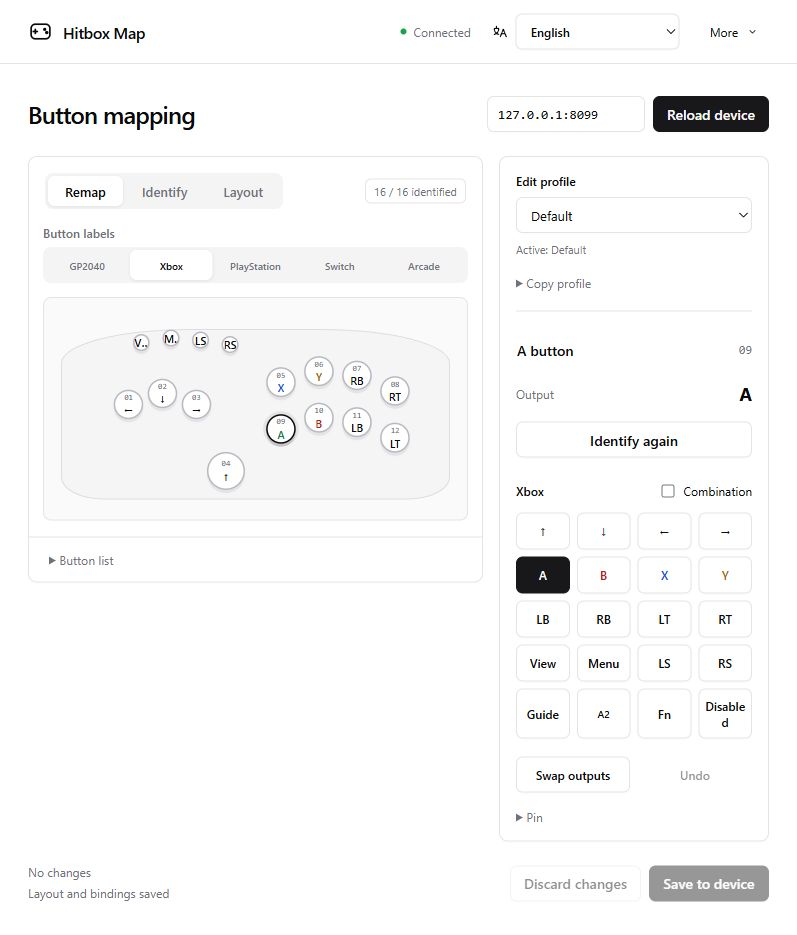
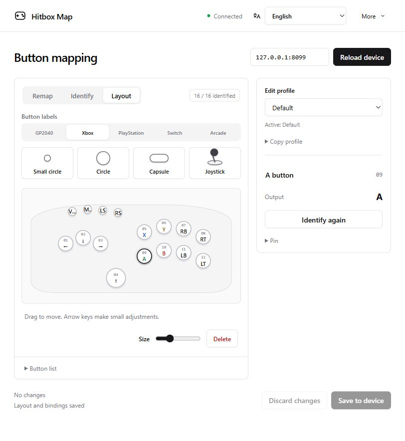

[简体中文](README.md) | [English](README.en.md) | [日本語](README.ja.md)

# Hitbox Map

GP2040-CE 控制器的本地改键工具。按实际位置摆放按钮，识别一次实体键，之后点击对应位置即可改键。

本文截图均为英文界面，使用模拟设备和示例布局。

## 启动与连接

1. 从 [Releases](https://github.com/MooWantFree/GP2040-hitbox-easy-UI/releases) 下载 Windows x64 压缩包，解压到可写的文件夹。尚无发布版时，可按[构建说明](docs/releasing.md)从 GitHub Actions 获取。
2. 双击 `HitboxMap.exe`，浏览器会打开管理页，任务栏托盘会出现程序图标。无需安装其他运行环境，也不需要重新刷固件。
3. 按住控制器的 Menu / Start 键插入 USB，进入 Web 配置模式。如果改过启动组合，使用自己的设置。
4. 在管理页填写设备地址，默认是 `192.168.7.1`，点击“连接”。

管理页默认地址为 `http://127.0.0.1:29301`。重复启动会打开已有实例；端口被其他程序占用时，会自动尝试下一个端口。

## 排列按钮

切到“布局”（Layout），将小圆点、圆形、胶囊或摇杆拖到画布。已有按钮可以拖动位置；选中后可以修改名称、调整大小或删除。摇杆通过中间的球头整体移动。

也可以用 Tab 聚焦形状，按 Enter 或空格添加到画布中央，再用方向键移动。按住 Shift 可加快移动。

## 识别实体键

1. 切到“识别”（Identify），点击画布上的一个位置。
2. 松开所有实体键，再按下并松开与该位置对应的键。每次等待最多 5 秒。
3. 重复以上步骤，直到需要的按键都已识别。摇杆的上下左右分别识别，每次只推一个方向。

如果实体键已绑定到其他位置，可以确认覆盖；原位置会恢复为未识别。两个实体键共用同一引脚时，无法独立改键。更换控制器或接线后，请重新识别。

按钮的位置、形状、名称和识别结果会自动保存。看到“布局与识别已保存”后，下次打开即可继续使用。

## 改键与保存

1. 切到“改键”（Remap），在“按钮名称”（Button labels）中选择 GP2040、Xbox、PlayStation、Switch 或 Arcade。
2. 点击画布上的按钮，在右侧选择输出。
3. 点击“保存到设备”（Save to device），检查改动，再点击“确认保存”（Confirm save）。
4. 完成后，从“更多 → 原版管理页”（More → Firmware settings）进入固件页面，将设备重启到手柄模式。

按钮名称只改变显示方式。需要切换固件输入模式、设置 SOCD、宏或灯效时，请使用原版管理页。建议保留 Menu / Start 的输出，方便下次进入 Web 配置模式。

| 操作 | 用法 |
| --- | --- |
| 交换按键（Swap outputs） | 选中一个按钮，点击“交换按键”，再选择另一个已识别的位置。 |
| 组合输出（Combination） | 勾选后选择多个输出，例如 X + LT；按下时同时触发。 |
| 编辑配置档（Edit profile） | 选择要修改的配置档。保存只写当前档；切换设备正在使用的档位需到原版管理页操作。 |
| 复制配置档（Copy profile） | 选择来源并复制到当前草稿，来源未保存的改动也会复制。 |
| 撤销 / 撤销改动 | “撤销”恢复所选按钮；“撤销改动”丢弃当前配置档的全部未保存改键。 |

布局自动保存，设备改键需要手动确认。编辑期间请避免同时在其他页面保存设备设置。

## 备份、迁移与更新

- “更多 → 导出布局 / 导入布局”用于备份或迁移按钮排列与识别结果。导入会替换当前布局。
- “更多 → 备份设备”下载 `.gp2040` 备份；保存改键前也会自动备份。恢复时，在原版管理页的 **Data Backup and Restoration** 导入该文件，导入后立即应用。
- 本地布局和设备备份保存在 EXE 旁的 `data` 文件夹。换电脑时一起复制；更新程序前先从托盘退出，替换 EXE 并保留 `data` 和自定义 `locales` 文件。

## 切换语言

顶部语言菜单可选择简体中文、English 或日本語。“自动”跟随浏览器的语言偏好，未匹配到时使用英语。托盘菜单跟随 Windows 用户语言。

添加自己的翻译：

1. 将 `locales/en.json` 复制为新文件，例如 `locales/fr.json`，放在 EXE 旁的 `locales` 文件夹。
2. 将 `locale` 改为 `fr`，将 `name` 改为菜单中显示的名称，例如 `Français`。
3. 翻译 `messages` 中的文字，保留键名和 `{0}`、`{1}` 等占位符。缺少的条目会显示英语。
4. 保存为 UTF-8，刷新网页即可在语言菜单中选择。托盘翻译需要重启程序。

## 退出程序

关闭网页后，程序仍在托盘运行。双击托盘图标可重新打开网页；右键图标，选择“退出程序”即可退出。找不到图标时，查看任务栏的隐藏图标区域。

构建与发布步骤见[发布说明](docs/releasing.md)，版本变更记录在 [CHANGELOG.md](CHANGELOG.md)。
